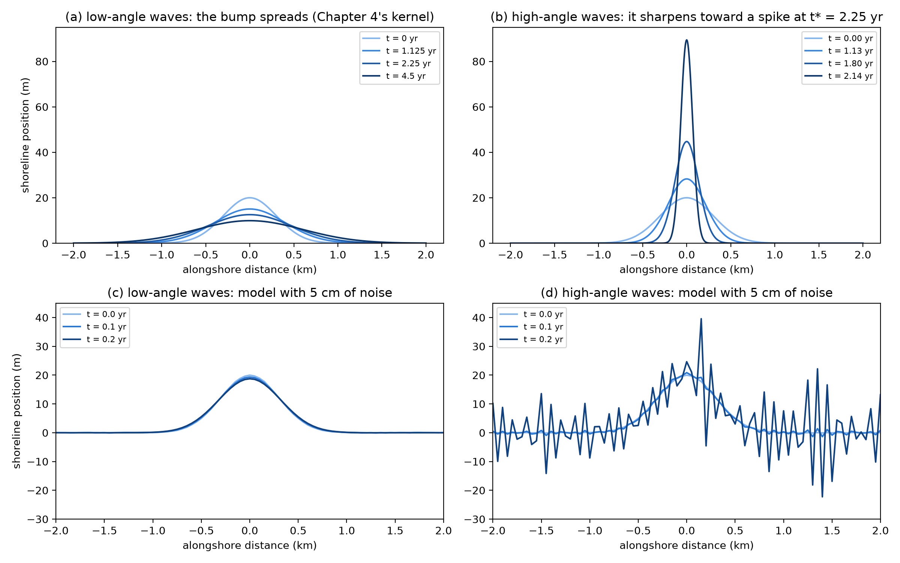

# chalk-flow

Study notes, reusable Python tools and automated checks for Appendix B, "Mathematical Tools and Resources", of Kundu, Cohen & Dowling, *Fluid Mechanics* (6th ed., 2016), with connections to Earth-surface dynamics.



## Progress

| Chapter | Topic | Folder | Status |
|---|---|---|---|
| 0 | Warm-up: worked solutions to the ten-minute diagnostic | `ch00_warmup/` | Done |
| 1 | Partial and total derivatives, material derivative, method of characteristics | `ch01_derivatives/` | Done |
| 2 | Changing independent variables, moving frames, similarity variables | `ch02_change_of_variables/` | Done |
| 3 | Vector calculus and integral theorems | `ch03_vector_calculus/` | Done |
| 4 | Dirac delta function and Green's functions | `ch04_dirac_delta/` | Done |
| 5 | Three-dimensional coordinate systems | `ch05_coordinates/` | Done |
| 6 | Equations in curvilinear coordinates | `ch06_curvilinear/` | Done |
| 7 | Capstone: shoreline instability under high-angle waves | `ch07_capstone/` | Done |

## What is inside

### Warm-up: `ch00_warmup/`

- **Contents:** step-by-step solutions to the ten warm-up questions at the start of the study guide, each with the intuition, the derivation and a SymPy or NumPy check
- **Figures:** [moving observers](ch00_warmup/figures/ch00_moving_observers.png), [delta function](ch00_warmup/figures/ch00_delta.png), [vortex vane](ch00_warmup/figures/ch00_vortex_vane.png)

### Chapter 1: `ch01_derivatives/`

- **Tools:** `material_derivative`, `knickpoint_travel_time`
- **Applications:** material derivative of a river tracer; knickpoint migration under stream-power incision
- **Figures:** [characteristics](ch01_derivatives/figures/ch01_characteristics.png), [knickpoint](ch01_derivatives/figures/ch01_knickpoint.png)

### Chapter 2: `ch02_change_of_variables/`

- **Tools:** `frozen_pattern_rate`, `diffusion_length`, `erf_step`, `scarp_profile`, `scarp_max_slope`, `scarp_morphologic_age`, `dune_bedload_flux`, `chi_transform`
- **Applications:** morphologic dating of fault scarps, dune tracking, chi transform of river profiles
- **Figures:** [moving frame](ch02_change_of_variables/figures/ch02_moving_frame.png), [similarity collapse](ch02_change_of_variables/figures/ch02_similarity_collapse.png), [knickpoint in chi space](ch02_change_of_variables/figures/ch02_chi_knickpoint.png)

### Chapter 3: `ch03_vector_calculus/`

- **Tools:** `levi_civita`, `cross_index`, `grad_2d`, `div_2d`, `curl_z_2d`, `laplacian_2d`, `area_integral`, `boundary_flux_rectangle`, `circulation_rectangle`, `exner_rate`, `steady_ridge_linear`, `steady_ridge_nonlinear`, `nonlinear_hillslope_flux`, `erosion_rate_from_hilltop_curvature`, `flow_divergence`
- **Applications:** Exner equation, linear and nonlinear hillslopes, erosion rates from hilltop curvature, flow convergence on DEMs
- **Figures:** [grad, div and curl](ch03_vector_calculus/figures/ch03_grad_div_curl.png), [hillslopes](ch03_vector_calculus/figures/ch03_hillslope.png), [flow routing](ch03_vector_calculus/figures/ch03_flow_routing.png)

### Chapter 4: `ch04_dirac_delta/`

- **Tools:** `gaussian_delta`, `sifting_integral`, `heat_kernel`, `diffuse_by_convolution`, `tracer_concentration`, `profile_moments`, `velocity_and_dispersion`, `nash_cascade_iuh`, `superpose_impulses`, `rainfall_runoff`, `coarse_grain`
- **Applications:** tracer tests (method of moments), unit hydrographs, sediment pulses, from grain tracking to continuum fields
- **Figures:** [delta family](ch04_dirac_delta/figures/ch04_delta_family.png), [Green's function](ch04_dirac_delta/figures/ch04_green_function.png), [impulse responses](ch04_dirac_delta/figures/ch04_impulse_responses.png)

### Chapter 5: `ch05_coordinates/`

- **Tools:** `scale_factors_and_unit_vectors`, `derivative_in_basis`, `radial_volume`, `latlon_cell_area`, `area_weighted_mean`, `coriolis_parameter`, `great_circle_distance`
- **Applications:** volumes of radial landforms, area-weighted averages of global grids, Earth's rotation
- **Figures:** [unit vectors](ch05_coordinates/figures/ch05_unit_vectors.png), [round Earth](ch05_coordinates/figures/ch05_round_earth.png)

### Chapter 6: `ch06_curvilinear/`

- **Tools:** `grad`, `div`, `laplacian`, `curl`, `vector_laplacian`, `advect_scalar`, `convective_acceleration`, `rankine_vortex`, `rankine_pressure`, `poiseuille_velocity`, `poiseuille_discharge`, `stokes_flow_sphere`, `stokes_stream_function`, `stokes_settling_velocity`, `ferguson_church_settling_velocity`, `rouse_number`, `rouse_profile`, `superelevation`, `thiem_head`, `theis_drawdown`, `steady_dome_profile`
- **Applications:** operators in any orthogonal coordinates, meander superelevation, settling and suspension, wells, diffusive domes
- **Figures:** [vortices](ch06_curvilinear/figures/ch06_vortices.png), [pipe and Stokes flow](ch06_curvilinear/figures/ch06_pipe_and_stokes.png), [grains and wells](ch06_curvilinear/figures/ch06_grains_and_wells.png)

### Chapter 7: `ch07_capstone/`

- **Tools:** `cerc_flux`, `cerc_flux_derivative`, `ashton_flux`, `ashton_flux_derivative`, `critical_angle`, `shoreline_diffusivity`, `growth_rate`, `efolding_time`, `gaussian_bump`, `blowup_time`, `shoreline_angle`, `step_one_line`, `run_one_line`
- **Applications:** high-angle-wave shoreline instability, a one-line shoreline model, reduced-complexity modelling
- **Figures:** [flux laws](ch07_capstone/figures/ch07_flux_laws.png), [running backwards](ch07_capstone/figures/ch07_running_backwards.png)

## Repository layout

- `guide/`: the study guide (LaTeX source and PDF)
- `ch00_warmup/`: worked solutions to the warm-up diagnostic (`ch00_notes.ipynb` and `figures/`)
- `chXX_*/`: one folder per chapter, each containing
  - `chXX_notes.ipynb`: notes, derivations, code and figures
  - `chXX_tools.py`: reusable functions, with docstrings and units
  - `test_chXX.py`: automated checks against known results
  - `figures/`: figures worth showing on GitHub
- `private/`: local files that are never committed (listed in `.gitignore`)

## Getting started

1. Create the environment (first time only):

   ```bash
   python3.12 -m venv .venv
   source .venv/bin/activate
   pip install -r requirements.txt
   ```

2. Strip notebook outputs on commit (once per clone): `nbstripout --install`
3. In later sessions, activate the environment: `source .venv/bin/activate`
4. Open the folder in VS Code (`code .`) and select the `.venv` kernel in each notebook (or run `jupyter lab`).
5. Run the checks: `pytest` (52 tests across the seven chapters).

## Workflow for each chapter

1. Study the section of the guide and write notes in `chXX_notes.ipynb`.
2. Restart the kernel, Run All, and **save** the notebook.
3. Run `pytest`.
4. `git add .`, `git commit`, `git push`.

Notebook outputs are removed on commit by nbstripout, so the figures worth keeping are saved as PNG files in each chapter's `figures/` folder. If `git status` lists a notebook as modified but `git diff` shows nothing, only its outputs changed: `git add` the notebook and the message disappears.

## Using the tools elsewhere

The chapter folders are not a package; add the folder you need to the import path:

```python
import sys
sys.path.append("path/to/chalk-flow/ch03_vector_calculus")
from ch03_tools import flow_divergence
```

## Reference

Kundu, P. K., Cohen, I. M., & Dowling, D. R. (2016). *Fluid Mechanics* (6th ed.). Academic Press.
The textbook PDF is not included in this repository. The research papers behind each application are listed in the references of the study guide in `guide/`.

## Acknowledgements

The study guide and the chapter notebooks, tools and tests in this repository were developed with assistance from Claude, an AI assistant made by Anthropic.
